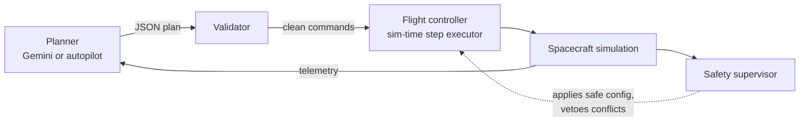

# OrbitGuard

**An autonomous flight controller for a 1U CubeSat, simulated with real orbital physics.**

An AI planner (Gemini, or a rule-based autopilot when there is no API key) flies a CubeSat in low Earth orbit: it dodges debris with properly sized avoidance burns, manages power and temperature, recovers from faults, and takes Earth images when it is safe to. A deterministic flight controller executes every plan, and a safety supervisor can veto anything the planner asks for.

---

## How decisions are made



- **The planner** proposes a short plan: attitude, power mode, payload, burns, safe mode, computer reboot. Gemini runs with structured JSON output and is shown the onboard solver's avoidance burn as an option. Without a key, or when a request fails, the autopilot plans instead.
- **The collision backstop** is the autopilot's avoidance rule, called by the simulation itself every 30 simulated seconds. It does not depend on the planner's wall-clock schedule, so it behaves the same at 1× and 500×. An event whose Pc climbs through 1e-4 as tracking improves raises its own alert (`CONJUNCTION_RED`) and an immediate planning cycle.
- **The validator** rejects unknown commands and bad parameters, normalises burn vectors and caps burns at 2 m/s. A plan built from telemetry more than 120 simulated seconds old is rejected as stale; at a warp where Gemini's reply would be that late, the autopilot plans routine cycles and Gemini is consulted on alerts with the warp held down.
- **The flight controller** runs plans on *simulation* time, so behaviour is identical at 1× and 500× warp. It aligns the thruster before every burn and fires for exactly the planned Δv. Every burn is checked against the whole screening list when it is armed and again just before ignition: one that would leave the worst collision probability at or above 1e-4 without lowering it is vetoed, whoever planned it.
- **The safety supervisor** latches with hysteresis. Battery below 15 % triggers survival mode, Sun-pointing and payload off, held until the battery is back above 30 %. A component past its temperature limit triggers sun-avoid and a CPU throttle. While latched, it vetoes only the commands that would undo the safe state, so an avoidance burn can still fly on a low battery.

## The physics

| System | Model |
|---|---|
| Orbit | Circular orbit with J2 nodal regression, altitude over the WGS-84 ellipsoid, real Earth rotation and Sun position |
| Drag decay | Exponential atmosphere (Vallado table) scaled by F10.7 and Kp, energy method `dr/dt = −ρ·Cd·(A/m)·v·r`, lifetime integrated to 200 km |
| Eclipse | Cylindrical Earth shadow against the real Sun direction, so eclipse length follows the beta angle |
| Attitude | Six pointing modes with 1.5 °/s slews; panel Sun incidence follows from the real geometry |
| Power | Two 5 W wings, 60 Wh 2S Li-ion pack with an OCV curve, no charging below 0 °C, thermostatic heater, per-load budget |
| Thermal | Eight radiative/conductive nodes: sunlight, Earth IR, albedo, `εσAT⁴` to space, electronics dissipation |
| Propulsion | 0.1 N cold gas at Isp 60 s; finite burns integrated with the rocket equation |
| Collision risk | Conjunction messages (TCA, miss vector, shrinking σ); Pc from **Chan's exact series**; burns shift every upcoming miss via the **Clohessy–Wiltshire** equations |
| Comms | Ground-station passes with a 5° mask, free-space link budget, data rate and latency |
| Radiation | LEO background, South Atlantic Anomaly, solar proton events; single-event upsets in the computer |
| Magnetic field | Tilted dipole (IGRF-14 pole) |
| Space weather | Live Kp and F10.7 (NOAA SWPC) and flares (NASA DONKI) when reachable; CMEs and proton events on the simulation clock |

Every formula is unit-tested: `npm test` runs 86 tests, including a brute-force integral that cross-checks Chan's series and regression tests for each bug fixed in v2. `npm run bench` flies 30 seeded three-day missions per scenario and prints a scorecard (missions lost, red conjunctions left unmitigated, Δv used, lowest battery).

## Running it

```bash
npm install
cp .env.example .env     # then add GEMINI_API_KEY (optional)
npm run dev              # http://localhost:5173
npm test
```

The key stays on the local Vite server (`server/api.js`). The browser asks `/api/plan`, so the key is never in the JavaScript bundle. The same server fetches CelesTrak, NOAA and NASA, which avoids browser CORS limits.

`npm run build` makes a static `dist/`. Served on its own (no Node server) it still runs, with the autopilot planning and simulated space weather. `npm run preview` serves the build *with* the API.

**No key?** The autopilot flies the whole mission. Drills on the *Drills & log* page exercise everything: debris on a collision course, an overheating computer, a battery cell failure, flares, CMEs, a solar wing hit, a radio lock-up and a severe storm.

## The assistant

The round button at the bottom right opens **Ask OrbitGuard**, a chat that explains the system and anything on screen. Tap **Explain** on an alert or on any log line and it gets the question, the current telemetry, the latest log entries and any browser errors as context. With `GEMINI_API_KEY` set it answers through the server (`POST /api/assist`, one question per second); without a key it answers from a built-in knowledge base (`src/assistant/knowledge.js`) covering the architecture, every override and error code, the data badges and the drills.

## The 3D views

- **Overview:** the real Earth (day and night, city lights, clouds) rotating at the true rate and lit by the Sun for the simulated date, with your orbit, ground stations and debris tracks near closest approach.
- **Satellite:** a 1U CubeSat built to the CubeSat Design Spec envelope, shown in its true attitude over the ground it is flying above. Thermal and x-ray modes, thruster plume, Sun, flight-direction and Earth vectors. **Drop any `.glb` / `.gltf` file** on the view to fly your own model (NASA publishes free ones at science.nasa.gov/3d-resources).

## Project structure

```
server/api.js              Local API: Gemini planner and assistant, CelesTrak, NOAA, NASA
src/
├── main.js                Mission director: clock, planner schedule, events
├── satellite.js           Spacecraft simulation (orbit → attitude → power → thermal → …)
├── physics.js             Drag, J2, geodetic altitude, rocket equation, CW, Chan Pc
├── sim/                   geometry, thermal, power, conjunctions, space weather
├── autonomy/              plan contract, flight controller + supervisor, autopilot, prompt
├── ai-brain.js            Browser client for /api/plan
├── assistant/             Knowledge base, live-context builder for the assistant
├── data-service.js, tle.js, feeds.js
├── webgl/                 Earth, orbit scene, CubeSat model, satellite close-up
├── views/, ui/            Pages, alert, modal, helpers
test/                      physics, flight controller, autonomy safety, services
scripts/benchmark.mjs      Seeded Monte Carlo scorecard for the autonomy stack
public/textures/           Earth maps (three.js examples, from NASA imagery)
```

## Honest limits

It is a teaching simulation, not flight software. The orbit is circular (no SGP4 propagation after initialisation). The atmosphere is an exponential fit, not NRLMSISE. Debris encounters are synthetic, though the object families are real. Thermal and power parameters are representative of a 1U, not a specific spacecraft.

## Credits

Earth textures from the three.js examples (MIT), derived from NASA Blue Marble and Black Marble imagery. Atmosphere table from Vallado, *Fundamentals of Astrodynamics and Applications*. Collision probability after Chan (1997, 2008). Operations concept informed by Castano et al., *Operations for Autonomous Spacecraft* (NASA JPL).

## License

MIT — see [LICENSE](LICENSE).
