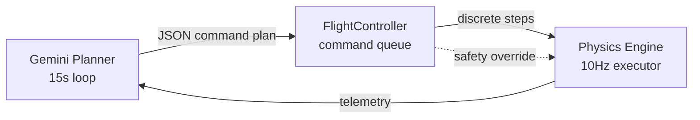

# OrbitGuard

**An autonomous flight controller for a 1U CubeSat, simulated with real orbital physics.**

A Gemini-powered AI acts as flight director for a satellite in Low Earth Orbit — budgeting power, holding thermal limits, managing comms blackouts, and planning collision-avoidance burns against live debris data. The physics underneath is not hand-waved: J2 perturbation, atmospheric drag, the Tsiolkovsky rocket equation, and Chan's collision-probability method.

> *Add a screenshot or GIF of the mission control dashboard here — it's the fastest way to show what this is.*

---

## Why it's interesting

Most "AI satellite" demos let the model move the spacecraft directly. This one doesn't. The AI is a **planner**, not an actuator — exactly how real spacecraft autonomy is structured.



The planner emits a structured JSON plan. The `FlightController` queues it, executes it step by step, and holds a **safety override** that can veto or abort a maneuver the physics says is unsafe. Plans carry a `plan_id` so a looping model can't double-execute, and an `EMERGENCY` priority flushes the queue instantly.

That separation means the satellite stays alive even when the AI is wrong, slow, or entirely offline — the flight computer falls back to deterministic rules.

---

## The physics is real

| System | Model | Why it matters |
|---|---|---|
| **Orbital decay** | Exponential atmospheric density, NRLMSISE-style banded layers | Altitude actually decays over the mission |
| **RAAN drift** | J2 perturbation from Earth's oblateness | The orbital plane precesses, like a real LEO orbit |
| **Fuel burns** | Tsiolkovsky rocket equation | Every burn permanently costs mass — fuel is finite |
| **Collision risk** | Chan's method, B-plane projection | Debris threat is a probability `Pc`, not a yes/no flag |
| **Power** | 60 Wh Li-ion, 10 W peak 1U panels | Sourced from AAC Clyde Space CubeSat specs |
| **Thermal** | −20 °C to +70 °C safe band | Sourced from NASA CubeSat 101 |

Full sourcing in [`REAL_SATELLITE_SPECS.md`](REAL_SATELLITE_SPECS.md).

**Live data**, with mock fallbacks when offline or rate-limited:
- **CelesTrak** — real TLE orbital elements (ISS as the reference orbit)
- **NASA DONKI** — real solar flare events, fed through a CME arrival-delay queue

---

## Features

- Mission control dashboard with live subsystem telemetry
- Five views — overview, ship systems, propulsion, space environment, crisis response
- 3D satellite and LIDAR debris visualization (Three.js)
- Time acceleration up to 100× to watch multi-orbit behavior
- Live AI decision log with reasoning for every command
- Survival score across power, thermal, comms, and orbit health
- Coronal mass ejection events with realistic propagation delay

---

## Running it

```bash
npm install
```

Copy the env template and add your key:

```bash
cp .env.example .env
```

Get a free Gemini API key at [aistudio.google.com/apikey](https://aistudio.google.com/apikey) and paste it into `.env`. Then:

```bash
npm run dev
```

Opens at `http://localhost:5173`. The satellite begins orbiting immediately.

**No API key?** It still runs. The flight computer drops to its deterministic safety rules and the AI decision log reports `AI_OFFLINE`.

---

## Project structure

```
src/
├── main.js                  # App orchestrator, physics tick, AI loop
├── satellite.js             # CubeSat state — power, thermal, comms, sensors
├── physics.js               # J2, drag, Tsiolkovsky, Chan collision probability
├── ai-brain.js              # Gemini planner + structured command schema
├── autonomy/
│   └── FlightController.js  # Command queue, step executor, safety override
├── data-service.js          # CelesTrak + NASA DONKI, with mock fallbacks
├── webgl/                   # Three.js satellite + LIDAR rendering
├── views/                   # Dashboard screens
└── ui/                      # Crisis alert system
```

---

## Tech

Vite · Vanilla JS (ES modules) · Three.js · satellite.js · Google Gemini 2.5 Flash

Built as a learning project to understand spacecraft autonomy and orbital mechanics from first principles.

---

## License

MIT — see [LICENSE](LICENSE).
